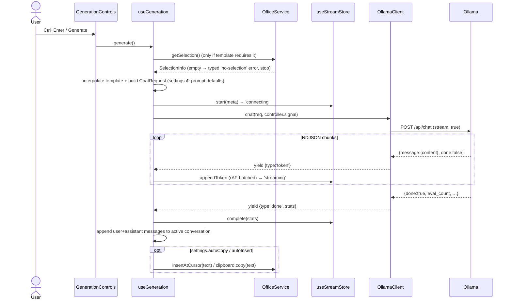

# GRETTA — Architecture

> Status: **pre-release** · Last updated: 2026-08-04
> Companion documents: [ROADMAP.md](./ROADMAP.md) · [DECISIONS.md](./DECISIONS.md)

GRETTA is a Microsoft Word **task pane add-in** that acts as a fully local AI writing
assistant powered by **Ollama**. No cloud services, no external APIs, no telemetry. The
target user is a scientist or professional writer working on manuscripts, grants, and
reviewer responses.

Unlike the existing WordOllama product (a Windows-only COM/VSTO add-in on .NET
Framework), GRETTA is built on **Office.js**, so a single codebase runs on Word for
Windows, Word for Mac, and Word on the web. Cross-platform support — especially macOS —
is a first-class architectural goal, not an afterthought (see §4).

---

## 1. Goals and non-goals

**Goals**

- Local-only inference via Ollama (`/api/chat`, `/api/generate`, `/api/tags`, `/api/show`).
- Token-by-token streaming with clean cancellation and graceful interruption handling.
- Rich document integration: read selection/paragraph/document, replace, insert, append,
  comment, highlight.
- A curated scientific-writing prompt library plus user-defined prompts.
- Persistent generation history (open, delete, export Markdown/JSON) and persistent settings.
- Copilot-like UX built with Fluent UI v9; keyboard-first; accessible.
- Production-quality engineering: strict TypeScript, layered architecture, testability.

**Non-goals (v1)** — designed for, but not implemented: RAG/embeddings/vector search,
PubMed/CrossRef/Zotero/Mendeley, citation generation, grammar-checker engines, track
changes, template engine, multiple AI providers, MCP, plugins, voice. See §16 for the
seams that keep these cheap to add later.

---

## 2. System context

```
┌──────────────────────────── User's machine ────────────────────────────┐
│                                                                         │
│  ┌───────────── Microsoft Word (host) ─────────────┐   ┌────────────┐   │
│  │                                                  │   │   Ollama   │   │
│  │  ┌──────────── Task pane (webview) ───────────┐  │   │  daemon    │   │
│  │  │  GRETTA SPA (React 19 + Fluent UI v9)   │  │   │ :11434     │   │
│  │  │                                             │  │   │            │   │
│  │  │  UI → features → stores → services          │  │   │  /api/chat │   │
│  │  │            │                │                │  │   │  /api/gen… │   │
│  │  │            │ Office.js      │ fetch (NDJSON) │──┼──▶│  /api/tags │   │
│  │  │            ▼                                 │  │   │  /api/show │   │
│  │  └────────────┼─────────────────────────────────┘  │   └────────────┘   │
│  │               ▼                                     │                    │
│  │        Word document (OOXML)                        │   localStorage     │
│  └─────────────────────────────────────────────────────┘   (settings,       │
│                                                             history,        │
│  Webview runtime: Edge WebView2 (Windows) / WKWebView (Mac)  custom prompts)│
└─────────────────────────────────────────────────────────────────────────────┘
```

Three external boundaries, each isolated behind a service:

| Boundary                     | Service               | Transport                                | Validation                             |
| ---------------------------- | --------------------- | ---------------------------------------- | -------------------------------------- |
| Word document                | `OfficeService`       | Office.js (`Word.run`)                   | typed wrappers, requirement-set gating |
| Ollama daemon                | `OllamaClient`        | `fetch` + NDJSON streaming               | Zod on every payload                   |
| KB companion (local, opt-in) | `KnowledgeBaseClient` | `fetch` over loopback HTTP(S)            | Zod on every payload (ADR-020)         |
| Local persistence            | `StorageService`      | `localStorage` adapter (async interface) | Zod + schema versioning/migration      |

**Rule zero:** no component, hook, or store touches `Office.js`, `fetch`, or
`localStorage` directly. Everything goes through these services (enforced by lint
boundaries + review, §5.2).

---

## 3. Runtime constraints and assumptions

1. **Webview runtimes.** Word on Windows hosts add-ins in Edge **WebView2** (Chromium);
   Word for Mac uses **WKWebView** (WebKit); Word on the web runs in the user's browser.
   Build target: ES2020, no IE-era polyfills.
2. **HTTPS task pane.** Add-in source URLs must be HTTPS (self-signed dev certs trusted
   via `office-addin-dev-certs` are fine for development).
3. **CORS.** Ollama enforces `OLLAMA_ORIGINS`. Its defaults allow `localhost` /
   `127.0.0.1` origins on any port, so a task pane served from `https://localhost:3000`
   works out of the box. If the add-in is ever hosted on a non-localhost domain, the user
   must add that origin to `OLLAMA_ORIGINS` (surfaced by in-app diagnostics, §12.3).
4. **Mixed content on Mac.** Chromium treats `http://localhost` as potentially
   trustworthy; WebKit historically blocks HTTPS→HTTP loopback requests as mixed content
   (WebKit bug 171934). This is the single biggest cross-platform risk and gets its own
   strategy in §4.
5. **Requirement sets.** Word JS APIs are versioned. Manifest baseline: **WordApi 1.3**;
   newer capabilities (e.g. comments, WordApi 1.4) are feature-gated at runtime via
   `Office.context.requirements.isSetSupported(...)`, never assumed.
6. **Single document context.** Office.js scopes the add-in to the active document; no
   cross-document orchestration in v1.
7. **Storage quota.** `localStorage` is origin-scoped and small (~5–10 MB). Conversations
   are text-only and pruned/exportable; the async `StorageService` interface allows an
   IndexedDB adapter later without touching callers (ADR-006).
8. **No downloads guarantee.** File downloads from task pane webviews are unreliable
   across hosts. Export therefore always offers clipboard as the guaranteed path, with
   Blob download attempted opportunistically (§13.4).

---

## 4. Platform support and the macOS strategy

| Capability                                     | Word Windows (WebView2)              | Word Mac (WKWebView)                   | Word on the web                                  |
| ---------------------------------------------- | ------------------------------------ | -------------------------------------- | ------------------------------------------------ |
| Office.js task pane                            | ✅                                   | ✅                                     | ✅                                               |
| `fetch https://localhost:3000` (dev assets)    | ✅                                   | ✅ (trusted dev cert)                  | ✅                                               |
| `fetch http://127.0.0.1:11434` from HTTPS pane | ✅ Chromium: loopback is trustworthy | ⚠️ **may be blocked as mixed content** | ⚠️ browser-dependent (Chrome/Edge ✅, Safari ⚠️) |
| `fetch https://localhost:<proxy>`              | ✅                                   | ✅                                     | ✅                                               |
| Clipboard API                                  | ✅                                   | ⚠️ fallback path needed                | ✅                                               |

**Strategy (ADR-008):**

1. **Default transport** is a plain `fetch` to the configured Ollama URL
   (`http://127.0.0.1:11434`). Works everywhere Chromium-based.
2. **Transport abstraction.** `OllamaClient` depends on an injected
   `HttpTransport` function type, so alternative transports are drop-in.
3. **HTTPS loopback proxy (Mac path).** The repo ships `scripts/ollama-https-proxy.mjs`
   — a ~60-line Node reverse proxy that terminates TLS using the same trusted
   `office-addin-dev-certs` certificate and forwards to `:11434`. Users on Mac set
   the Ollama URL setting to `https://localhost:11435`. HTTPS→HTTPS: no mixed content.
4. **Runtime diagnostics** (§12.3) detect _which_ failure mode occurred (daemon down vs.
   CORS vs. mixed content) and show targeted, friendly setup instructions.
5. **Validation spike** on real Word for Mac is scheduled in Phase 2 before UI work
   begins (see ROADMAP), because this assumption gates the product's differentiator.

---

## 5. Layered architecture

### 5.1 Layers and the dependency rule

```
┌────────────────────────────────────────────────────────────┐
│ app/            composition root, providers, shell, views  │
├────────────────────────────────────────────────────────────┤
│ features/       ai · prompts · settings · history ·        │
│                 document   (UI + hooks + feature stores)   │
├────────────────────────────────────────────────────────────┤
│ components/ · hooks/        shared, feature-agnostic       │
├────────────────────────────────────────────────────────────┤
│ services/       office · ollama · storage · clipboard      │
├────────────────────────────────────────────────────────────┤
│ types/ · utils/ · styles/   pure, dependency-free          │
└────────────────────────────────────────────────────────────┘
```

Dependencies point **downward only**. Services never import React. `types/` and `utils/`
import nothing above them.

### 5.2 Allowed imports

| From ↓ may import → | app | features                             | components | hooks | services             | types/utils |
| ------------------- | --- | ------------------------------------ | ---------- | ----- | -------------------- | ----------- |
| **app**             | —   | ✅                                   | ✅         | ✅    | ✅                   | ✅          |
| **features**        | ❌  | public API of sibling features only¹ | ✅         | ✅    | ✅                   | ✅          |
| **components**      | ❌  | ❌                                   | ✅         | ❌    | ❌                   | ✅          |
| **hooks** (shared)  | ❌  | ❌                                   | ❌         | ✅    | ✅                   | ✅          |
| **services**        | ❌  | ❌                                   | ❌         | ❌    | sibling services ❌² | ✅          |
| **types/utils**     | ❌  | ❌                                   | ❌         | ❌    | ❌                   | ✅          |

¹ Cross-feature imports go through the feature's `index.ts` barrel only (e.g. `features/ai`
may read `useSettingsStore` from `features/settings`).
² Services stay independent of each other; orchestration lives in feature hooks.

Enforcement: `eslint-plugin-boundaries` (dev-only dependency) + code review. Direct
imports of `office.js` globals or bare `fetch` outside `services/` fail lint.

### 5.3 Project structure

```
gretta/
├─ manifest/
│  └─ manifest.xml                 # add-in only (XML) manifest → https://localhost:3000
├─ public/assets/                  # icon-16/32/80.png, logo
├─ scripts/
│  ├─ ollama-https-proxy.mjs       # macOS mixed-content workaround (§4)
│  ├─ dev-mac.mjs                  # one-command Mac loader: sideload + dev + proxy + kb
│  ├─ kb/                          # knowledge-base companion (ADR-020), run via type-stripping
│  │  ├─ server.mts                # HTTP(S) API: collections CRUD, reindex, status stream, query
│  │  ├─ registry.mts              # collection registry + debounced file watchers
│  │  ├─ index-store.mts           # incremental scan → parse → chunk → embed → store
│  │  ├─ store.sqlite.mts          # durable chunks/vectors keyed by (collection, path, hash)
│  │  ├─ parse.mts                 # pdf.js (page locators) / mammoth (¶ locators) / text
│  │  ├─ chunk.mts                 # pure structural chunker (provenance-preserving)
│  │  ├─ score.mts                 # pure cosine + top-k ranking
│  │  ├─ embedder.mts              # Ollama embeddings + deterministic offline seam
│  │  └─ progress.mts              # NDJSON progress encode/parse
│  └─ sideload.md                  # per-platform sideloading instructions
├─ taskpane.html                   # Vite entry → src/main.tsx
├─ commands.html                   # minimal function-command runtime (manifest requirement)
├─ src/
│  ├─ main.tsx                     # Office.onReady gate → mount <App/>
│  ├─ app/
│  │  ├─ App.tsx                   # FluentProvider, layout shell, view switch
│  │  ├─ services.ts               # composition root (createServices / getServices / setServices)
│  │  ├─ queryClient.ts            # TanStack Query client + defaults
│  │  ├─ ui.store.ts               # ephemeral UI state (active view, dialogs)
│  │  └─ views/                    # ChatView, HistoryView, SettingsView, KnowledgeBaseView
│  ├─ features/
│  │  ├─ ai/                       # generation orchestration
│  │  │  ├─ index.ts               # public API
│  │  │  ├─ stream.store.ts        # streaming state machine
│  │  │  ├─ useGeneration.ts       # the core hook (§11.1)
│  │  │  ├─ useModels.ts           # TanStack Query: tags/show/health
│  │  │  ├─ context/               # ContextProvider pipeline (§16) + knowledgeBaseProvider
│  │  │  └─ components/            # ModelPicker, GenerationControls, ResponseView, ConnectionBanner
│  │  ├─ prompts/
│  │  │  ├─ builtins.ts            # 12 built-in PromptTemplates
│  │  │  ├─ prompts.store.ts       # custom prompts (persisted)
│  │  │  ├─ template.ts            # {{selection}} / {{document}} / {{input}} interpolation
│  │  │  └─ components/            # PromptPicker, PromptEditorDialog
│  │  ├─ settings/
│  │  │  ├─ settings.store.ts      # persisted AppSettings
│  │  │  └─ components/            # SettingsPanel (React Hook Form + Zod resolver)
│  │  ├─ history/                  # generation records, not chat threads (ADR-021)
│  │  │  ├─ history.store.ts       # persisted records, capped at HISTORY_LIMIT
│  │  │  ├─ export.ts              # → Markdown / JSON (includes cited sources)
│  │  │  └─ components/            # HistoryList
│  │  ├─ knowledgebase/
│  │  │  ├─ knowledgebase.store.ts # document binding + live index progress
│  │  │  ├─ useDocumentBinding.ts  # binding persisted IN the .docx (Office settings)
│  │  │  └─ components/            # KnowledgeBasePanel (collections + capacity + binding)
│  │  └─ document/
│  │     ├─ useDocumentActions.ts  # copy / replace / insert / append / comment / highlight
│  │     └─ components/            # ResultActionsBar, ContextSourcePicker
│  ├─ components/                  # shared presentational (ErrorBanner, EmptyState, Kbd…)
│  ├─ hooks/                       # useKeyboardShortcuts, useOfficeReady, useTheme
│  ├─ services/
│  │  ├─ office/
│  │  │  ├─ office.service.ts      # the ONLY Office.js call site
│  │  │  ├─ office.types.ts        # OfficeService interface + result types
│  │  │  ├─ requirements.ts        # requirement-set constants + isSupported()
│  │  │  └─ office.mock.ts         # in-memory document for browser dev + tests
│  │  ├─ ollama/
│  │  │  ├─ client.ts              # OllamaClient impl (AsyncIterable streaming)
│  │  │  ├─ client.types.ts        # interface + request/event types
│  │  │  ├─ schemas.ts             # Zod schemas for all endpoints
│  │  │  ├─ ndjson.ts              # incremental NDJSON line parser
│  │  │  ├─ transport.ts           # HttpTransport type + default fetch transport
│  │  │  └─ diagnostics.ts         # offline/CORS/mixed-content discrimination
│  │  ├─ knowledgebase/
│  │  │  ├─ client.ts              # KB companion client (the 2nd permitted fetch call site)
│  │  │  ├─ client.types.ts        # interface + transport seam
│  │  │  └─ schemas.ts             # Zod schemas for /health, /collections, /query
│  │  ├─ storage/
│  │  │  ├─ storage.types.ts       # StorageService interface
│  │  │  ├─ local-storage.adapter.ts
│  │  │  └─ keys.ts                # namespaced key registry ('gretta/…')
│  │  └─ clipboard/
│  │     └─ clipboard.service.ts   # navigator.clipboard + execCommand fallback
│  ├─ types/                       # domain model (§6), errors (§12), Result helpers
│  ├─ utils/                       # id(), now(), rafBatcher(), download.ts
│  └─ styles/                      # global.css, tokens
├─ tests/                          # integration fixtures (NDJSON streams, Office mocks)
├─ e2e/                            # Playwright (browser dev mode, §14.4)
└─ (config) vite.config.ts · tsconfig.json · eslint.config.js · vitest.config.ts ·
   playwright.config.ts · .prettierrc · package.json (pnpm)
```

Stores are **colocated with their feature** rather than a global `stores/` directory —
the store _is_ part of the feature's public API (ADR-005). File size target: ≤ ~300 lines.

---

## 6. Domain model (core types)

```ts
// types/domain.ts — abbreviated; JSDoc omitted here for brevity, required in code.

export type Role = 'system' | 'user' | 'assistant';

export interface ChatMessage {
  id: string;
  role: Role;
  content: string;
  createdAt: string; // ISO 8601
  model?: string; // assistant messages
  stats?: GenerationStats; // assistant messages, from Ollama's final chunk
}

export interface Conversation {
  id: string;
  title: string;
  createdAt: string;
  updatedAt: string;
  messages: ChatMessage[];
}

export interface GenerationStats {
  totalDurationMs: number;
  evalCount: number; // output tokens
  promptEvalCount: number;
  tokensPerSecond: number; // derived
}

export type PromptContextVar = 'selection' | 'paragraph' | 'document' | 'input';

export interface PromptTemplate {
  id: string;
  name: string;
  category: 'scientific' | 'editing' | 'style' | 'grants' | 'communication' | 'custom';
  description: string;
  system: string; // system prompt
  user: string; // may reference {{selection}} {{paragraph}} {{document}} {{input}}
  requires: PromptContextVar[]; // gate UI + produce 'no-selection' errors early
  builtIn: boolean;
  defaults?: Partial<GenerationOptions>; // e.g. proofreading → temperature 0.2
}

export interface GenerationOptions {
  temperature: number; // 0–2
  topP: number; // 0–1
  topK: number; // ≥ 0 integer
  seed: number | null; // null → omit (non-deterministic)
  contextLength: number; // Ollama options.num_ctx
}

export type ThemePreference = 'light' | 'dark' | 'system' | 'office';

export interface AppSettings extends GenerationOptions {
  ollamaUrl: string; // default 'http://127.0.0.1:11434'
  defaultModel: string | null;
  streaming: boolean;
  theme: ThemePreference;
  autoCopy: boolean; // copy result to clipboard on completion
  autoInsert: boolean; // insert result at cursor on completion
}
```

All persisted shapes (`AppSettings`, `Conversation[]`, custom `PromptTemplate[]`) have
matching Zod schemas in the owning feature and a payload envelope
`{ version: number, data: T }` (§13.2).

---

## 7. Service interfaces

### 7.1 `OfficeService` — the only Office.js call site

```ts
// services/office/office.types.ts

export interface HostInfo {
  available: boolean; // false in browser dev mode
  host: 'Word' | 'unknown';
  platform: 'PC' | 'Mac' | 'OfficeOnline' | 'unknown';
}

export interface SelectionInfo {
  text: string;
  isEmpty: boolean; // collapsed cursor / whitespace-only
}

export interface OfficeService {
  /** Resolves once Office.onReady has fired (immediately in mock mode). */
  ready(): Promise<HostInfo>;
  isApiSupported(set: 'WordApi', version: string): boolean;

  getSelection(): Promise<SelectionInfo>;
  getParagraph(): Promise<string>; // paragraph containing the cursor
  getDocument(): Promise<string>; // full body text
  replaceSelection(text: string): Promise<void>;
  insertAtCursor(text: string): Promise<void>;
  appendText(text: string): Promise<void>;
  createComment(text: string): Promise<void>; // WordApi 1.4 — gated
  highlightSelection(color?: HighlightColor): Promise<void>;
}
```

Implementation notes:

- Every method wraps `Word.run`, batches `load()`/`sync()` correctly, and normalizes
  failures into typed `OfficeError`s (§12.1). Errors never escape as raw `OfficeExtension.Error`.
- Text insertion uses `insertText(...)` exclusively — never `insertHtml` (§13.1).
- Requirement-set gating (baseline WordApi 1.3 in the manifest; exact per-method minimums
  verified against the official reference in Phase 3 — recorded in `requirements.ts`, never
  guessed inline):

| Method                                           | API surface                            | Gate                                                                        |
| ------------------------------------------------ | -------------------------------------- | --------------------------------------------------------------------------- |
| get/replace selection, insert, append, highlight | `Body`, `Range`, `Font.highlightColor` | manifest baseline                                                           |
| `getParagraph`                                   | `Range.paragraphs.getFirst()`          | baseline (verify 1.3)                                                       |
| `createComment`                                  | `Range.insertComment`                  | runtime check `WordApi 1.4` → friendly "not supported on this Word version" |

- `office.mock.ts` implements the same interface over an in-memory document string with a
  cursor/selection model. It powers unit tests, Playwright, and `pnpm dev:web`.

### 7.2 `OllamaClient` — isolated API client

```ts
// services/ollama/client.types.ts

export type HttpTransport = (url: string, init: RequestInit) => Promise<Response>;

export interface OllamaModel {
  name: string; // e.g. 'llama3.1:8b'
  size: number;
  modifiedAt: string;
  parameterSize?: string;
  quantization?: string;
}

export interface ChatRequest {
  model: string;
  messages: Array<{ role: Role; content: string }>;
  options: OllamaOptions; // temperature, top_p, top_k, seed?, num_ctx
  stream: boolean;
}

export interface GenerateRequest {
  model: string;
  prompt: string;
  system?: string;
  options: OllamaOptions;
  stream: boolean;
}

export type StreamEvent =
  { type: 'token'; content: string } | { type: 'done'; stats: GenerationStats };

export interface OllamaClient {
  /** GET /api/version — cheap reachability + CORS probe. */
  health(signal?: AbortSignal): Promise<{ version: string }>;
  /** GET /api/tags */
  listModels(signal?: AbortSignal): Promise<OllamaModel[]>;
  /** POST /api/show */
  showModel(name: string, signal?: AbortSignal): Promise<OllamaModelDetails>;
  /**
   * POST /api/chat. Always returns an async iterable; when stream=false it yields
   * exactly one 'token' event followed by 'done'. Cancel via the AbortSignal —
   * aborting closes the connection, which stops generation server-side.
   */
  chat(req: ChatRequest, signal: AbortSignal): AsyncIterable<StreamEvent>;
  /** POST /api/generate — same contract as chat(). */
  generate(req: GenerateRequest, signal: AbortSignal): AsyncIterable<StreamEvent>;
}
```

- Constructed via `createOllamaClient({ baseUrl, transport, timeoutMs })`; `baseUrl` is
  read from settings at call time so URL changes apply without reloads.
- **Every** response body — including each stream chunk — passes through Zod
  (`schemas.ts`). Invalid payloads become `OllamaError('invalid-response')`, never
  runtime `undefined`s.
- Ollama error bodies (`{ "error": "..." }`, e.g. model not found) are parsed and mapped
  to typed errors.
- Timeouts: connection/first-byte timeout via `AbortSignal.timeout` composed with the
  caller's signal; no inter-token timeout by default (long generations are legitimate).

### 7.3 `StorageService` and `ClipboardService`

```ts
export interface StorageService {
  get<T>(key: StorageKey, schema: z.ZodType<T>): Promise<T | null>; // null on missing OR invalid (logged)
  set<T>(key: StorageKey, value: T): Promise<void>;
  remove(key: StorageKey): Promise<void>;
}

export interface ClipboardService {
  copy(text: string): Promise<void>; // navigator.clipboard → execCommand fallback
}
```

Async by design so an IndexedDB adapter can replace `localStorage` without caller
changes. Keys are centrally registered (`gretta/settings`, `gretta/history` —
which now holds generation history at version 2, the key string kept so existing data
migrates in place per ADR-021 —
`gretta/prompts`).

### 7.4 Composition root (dependency inversion without a framework)

```ts
// app/services.ts
export interface Services {
  office: OfficeService;
  ollama: OllamaClient;
  storage: StorageService;
  clipboard: ClipboardService;
}

let services: Services = createDefaultServices(); // picks office.mock when VITE_OFFICE_MOCK=1
export const getServices = (): Services => services;
/** Test/dev only — swap implementations. */
export const setServices = (overrides: Partial<Services>): void => {
  services = { ...services, ...overrides };
};
```

Hooks and stores consume `getServices()`. No React Context, no DI container — one module,
trivially overridable in tests (ADR-003).

---

## 8. State management

| Store / cache      | Location          | Persistence                                               | Owns                                                                                                          |
| ------------------ | ----------------- | --------------------------------------------------------- | ------------------------------------------------------------------------------------------------------------- |
| `useSettingsStore` | features/settings | ✅ zustand `persist` (version+migrate) via StorageService | `AppSettings`                                                                                                 |
| `useHistoryStore`  | features/history  | ✅ persisted (capped)                                     | flat `GenerationRecord[]`, `activeRecordId`, add/delete/clear, `markApplied` (ADR-021)                        |
| `usePromptsStore`  | features/prompts  | ✅ persisted (custom prompts only)                        | custom `PromptTemplate`s, `selectedPromptId`                                                                  |
| `useStreamStore`   | features/ai       | ❌ ephemeral                                              | streaming state machine (§9), response buffer, active request meta                                            |
| `useUiStore`       | app/              | ❌ ephemeral                                              | active view, open dialogs, banners                                                                            |
| TanStack Query     | app/queryClient   | in-memory cache                                           | **server state only**: `['ollama','health']` (refetch 15 s), `['ollama','models']`, `['ollama','model',name]` |

Boundary: **Zustand = client state, TanStack Query = Ollama server-cache state.**
Generation itself is _not_ a Query mutation — streaming lifecycles fit the explicit
`useStreamStore` machine better (ADR-005). React Context is used only where Fluent UI
requires it (`FluentProvider`), never for app state.

---

## 9. Streaming pipeline

```
fetch(res.body)  ReadableStream<Uint8Array>
      │  TextDecoder(stream:true)
      ▼
  ndjson.ts  — buffers partial lines across chunks, splits on '\n',
      │        JSON.parse per line, Zod-validate → typed chunk
      ▼
  client.ts — maps chunks → StreamEvent ('token' | 'done'), throws typed errors
      │        (AsyncIterable; return() aborts the underlying reader)
      ▼
  useGeneration — for-await loop; owns AbortController
      │
      ▼
  useStreamStore — status machine + rAF-batched buffer appends
      ▼
  ResponseView — renders text (plain, whitespace-preserved), auto-scroll
```

**State machine** (`useStreamStore.status`):

```
idle ─start()→ connecting ─firstToken→ streaming ─done→ completed
  ▲                │                        │
  │                │ error                  ├─ cancel() → cancelled (keeps partial text)
  └── reset() ─────┴────────── error ◄──────┘  (keeps partial text + error)
```

Rules:

- **Cancellation** = `AbortController.abort()`. Closing the connection stops Ollama's
  generation server-side. `cancelled` is a _normal_ terminal state, not an error;
  partial output remains usable (copy/insert still work).
- **Interruption** (network drop, daemon killed mid-stream, malformed line) →
  `StreamError('interrupted' | 'parse')`, partial text preserved, friendly banner offers
  Retry.
- **Performance:** token appends are batched with `requestAnimationFrame` so a fast model
  causes ≤ ~60 store updates/sec regardless of token rate; `ResponseView` is the only
  subscriber to the buffer selector.
- Non-streaming mode (settings): identical code path — client yields one token + done.

---

## 10. UI composition (Copilot-style pane)

```
┌──────────────────────────────┐
│ [Model ▾]  [Prompt ▾]   ⚙ 🕘 │  ← header: pickers, settings, history
├──────────────────────────────┤
│ ConnectionBanner (if needed) │
├──────────────────────────────┤
│ Prompt input (textarea)      │
│ context chip: Selection ▾    │  ← which {{var}} feeds the template
├──────────────────────────────┤
│ [Generate] [Stop] [Clear]    │
├──────────────────────────────┤
│ Streaming response (scroll)  │
│  …tokens render live…        │
├──────────────────────────────┤
│ [Copy][Replace][Insert][⇩]   │  ← ResultActionsBar (+ Comment when supported)
└──────────────────────────────┘
```

- Fluent UI v9 (`@fluentui/react-components`), `FluentProvider` themed from
  `settings.theme`; `'office'` maps `Office.context.officeTheme` → web light/dark tokens.
- Keyboard shortcuts (registered in one `useKeyboardShortcuts` hook, active only when the
  pane has focus): `Ctrl/⌘+Enter` generate · `Esc` stop · `Ctrl/⌘+Shift+C` copy result ·
  `Ctrl/⌘+Shift+I` insert at cursor. Documented in a `Kbd` legend inside Settings.
- Task panes get narrow (~300 px): single-column, wrap-friendly toolbars, no fixed widths.
- Accessibility: Fluent primitives for focus/roles; response region uses a _debounced_
  `aria-live="polite"` announcement (announce on completion and every ~2 s during
  streaming — per-token announcements are hostile to screen readers); all actions
  reachable by keyboard; visible focus rings.

---

## 11. Key data flows

### 11.1 Generate with streaming



Failure branches: abort → `cancelled`; transport/parse failure → `error` with partial
text; every branch also finalizes the conversation entry so history never loses content.

### 11.2 Startup

`main.tsx` awaits `officeService.ready()` (with a timeout → browser/mock mode banner) →
mounts `<App/>` → persisted stores rehydrate through `StorageService` (invalid payloads
fall back to defaults + toast) → TanStack Query fetches health + models → model selection
resolves to `settings.defaultModel` if installed, else first available, else the
ConnectionBanner takes over with diagnostics.

### 11.3 Document actions

`ResultActionsBar` → `useDocumentActions` → `OfficeService`. Each action is disabled with
a tooltip when impossible (no result yet, host unavailable, API unsupported) rather than
failing after the click. `Replace Selection` re-checks the selection at click time.

---

## 12. Error handling

### 12.1 Taxonomy

```ts
// types/errors.ts
export type AppError =
  | OfficeError // 'host-unavailable' | 'no-document' | 'no-selection' | 'api-unsupported' | 'office-failed'
  | OllamaError // 'offline' | 'cors-or-mixed-content' | 'timeout' | 'http' | 'model-not-found' | 'invalid-response'
  | StreamError // 'interrupted' | 'parse'   (user cancellation is a state, not an error)
  | StorageError; // 'quota-exceeded' | 'corrupt'
```

Typed `Error` subclasses carrying `kind`, `code`, `cause`, and optional `partialText`.
`toAppError(unknown)` normalizes anything at service boundaries.

### 12.2 Presentation

A single `describeError(e): { title; detail; action? }` map produces every user-facing
message — friendly, specific, and actionable ("Ollama isn't reachable at
http://127.0.0.1:11434 — is it running? Try `ollama serve`."). Inline banners for
connection state; toasts for transient action failures; never a blank crash — the app
shell wraps views in an error boundary with a reset button.

### 12.3 Connection diagnostics (`services/ollama/diagnostics.ts`)

Browsers report offline, CORS-blocked, and mixed-content-blocked identically (opaque
`TypeError`). Discrimination heuristic:

1. `fetch(baseUrl, { mode: 'no-cors' })` — resolves (opaque) if the daemon is reachable;
   rejects if it's down. → distinguishes **offline** from **policy-blocked**.
2. If reachable but the normal CORS request fails: on `platform === 'Mac'` with an
   `http:` URL → surface the **mixed-content** guidance (use the HTTPS proxy script);
   otherwise → **CORS** guidance (`OLLAMA_ORIGINS`).

The ConnectionBanner renders the matching walkthrough. Every message keeps the "Never
crash" contract: degraded, explained, recoverable.

---

## 13. Security

1. **Model output is data, never code.** Rendered as plain text
   (`white-space: pre-wrap`) via React's default escaping — no `dangerouslySetInnerHTML`,
   no Markdown-to-HTML in v1 (a sanitized renderer is a designed-for extension, §16).
   Inserted into Word via `insertText` only, never `insertHtml`.
2. **Validate everything external**: Ollama responses, stream chunks, and persisted
   storage all pass Zod before use; failures degrade to typed errors/defaults.
3. **No dynamic evaluation** — no `eval`, no `new Function`, template interpolation is a
   literal string replace with no expression language.
4. **Exports** are generated client-side; clipboard is the guaranteed path, Blob download
   attempted opportunistically (host-dependent).
5. **Local by default** (ADR-028): the network peers are the user-configured Ollama URL,
   the loopback knowledge-base companion when enabled, and — only when a source is
   individually switched on — the scholarly APIs used by literature search. Generation
   never opens a socket: literature results reach a prompt only after being ingested into
   the knowledge base as ordinary documents, so no literature code runs in the generation
   path. A strict CSP (`default-src 'self'; connect-src` those origins + `appsforoffice`
   CDN) is defined at hosting time, and the scholarly hosts are declared in the manifest's
   `AppDomains`. Note that CSP is static and cannot express a per-source toggle: it bounds
   the blast radius to a known host list, while the Settings toggles are the control that
   decides what is actually contacted.
6. **Knowledge base** (ADR-020): the companion binds to loopback only and is opt-in.
   Indexed content, absolute folder paths, and embeddings never leave the machine —
   embeddings are computed by the user's own Ollama. Retrieved excerpts are treated
   exactly like model output: data, never instructions, injected as a clearly delimited
   block and rendered as plain text. The document→collection binding is stored in the
   .docx (`Office.context.document.settings`), so it travels with the file rather than
   living in shared app state; it contains collection ids, not document content.

---

## 14. Testing strategy

| Level       | Tooling                          | Targets                                                                                                                                                                                    |
| ----------- | -------------------------------- | ------------------------------------------------------------------------------------------------------------------------------------------------------------------------------------------ |
| Unit        | Vitest                           | `ndjson.ts` (chunk-boundary torture tests), Zod schemas, template interpolation, exporters, error mapping, stores                                                                          |
| Component   | Vitest + Testing Library + jsdom | pickers, controls, ResponseView, SettingsPanel — services swapped via `setServices()`                                                                                                      |
| Integration | Vitest                           | `useGeneration` against a scripted fake transport (`ReadableStream` fixtures: happy path, cancel mid-stream, malformed line, connection drop); `OfficeService` against `office-addin-mock` |
| E2E         | Playwright                       | full UI in **browser dev mode** (`VITE_OFFICE_MOCK=1`): type → stream → cancel → insert-into-mock-doc → export; keyboard-only run; light/dark                                              |

Principles: mock **Ollama at the transport seam** (hand-rolled `HttpTransport` fakes — no
MSW dependency) and **Office at the service seam** (plus `office-addin-mock` for the
implementation itself). Manual in-Word smoke checklists per platform complement E2E
(true in-host automation is out of scope for v1).

---

## 15. Performance notes

- rAF-batched token rendering (§9); memoized selectors; response view is the sole
  buffer subscriber.
- Fluent v9 is tree-shaken via named imports; bundle budget ≤ ~500 KB gz checked in CI.
- Full-document reads are on-demand only (never polled) and size-guarded with a warning
  before stuffing very large documents into a small `num_ctx`.
- Conversation list virtualization is deferred until proven necessary (text-only data).

---

## 16. Extensibility seams (designed now, built later)

| Future capability                     | Seam that already exists                                                                                                                                                                                         |
| ------------------------------------- | ---------------------------------------------------------------------------------------------------------------------------------------------------------------------------------------------------------------- |
| Multiple AI providers                 | `OllamaClient` interface → extract `CompletionProvider`; UI already model-agnostic                                                                                                                               |
| RAG / embeddings / vector search      | ✅ **Built** (Phase 11, ADR-020): `scripts/kb` companion indexes folders into named collections; `services/knowledgebase` client; a `ContextProvider[]` pipeline in `useGeneration`; citations in `ResponseView` |
| PubMed / CrossRef / Zotero / Mendeley | new `services/<source>` + a citation feature; no UI assumptions block it                                                                                                                                         |
| Citation generation / template engine | `PromptTemplate.user` interpolation is a single function — swap for a richer engine behind the same signature                                                                                                    |
| Grammar checking, comments generation | `OfficeService.createComment` + `highlightSelection` already exposed; batch-apply is a feature-level loop                                                                                                        |
| Track changes                         | additive `OfficeService` methods gated on the relevant WordApi set                                                                                                                                               |
| MCP servers / plugins                 | providers + prompt sources are registry-shaped (`builtins.ts` + store) — a plugin is another registrar                                                                                                           |
| Markdown rendering                    | `ResponseView` renders through one `<ResponseContent/>` component — swap plain text for a sanitized renderer in one place                                                                                        |
| Voice dictation                       | input is a controlled component; dictation is another writer to the same store field                                                                                                                             |

---

## 17. Open questions → spikes

Resolutions get ADRs; see [DECISIONS.md](DECISIONS.md).

1. **Word-for-Mac loopback fetch** — ✅ resolved (Phase 2 spike, real Word for Mac):
   direct HTTP is blocked exactly as predicted; the HTTPS proxy works and is the
   documented Mac path (ADR-008).
2. **Fluent UI v9 ⊕ React 19 peer support** — ✅ resolved (Phase 2): Fluent 9.74.3
   declares `react >=16.14 <20`; verified under React 19.2.7 StrictMode (ADR-013).
3. **Exact WordApi requirement-set minimums** — ✅ resolved (Phase 3, from the reference
   annotations in `@types/office-js`): every core member is 1.1; `Range.insertComment`
   is 1.4 (runtime-gated). The 1.3 manifest floor stands because `paragraphs`
   collections exclude table paragraphs below 1.3 — full audit in
   `src/services/office/requirements.ts`.
4. **Blob downloads inside task panes** per host — Phase 8; clipboard export is the
   guaranteed fallback either way.
